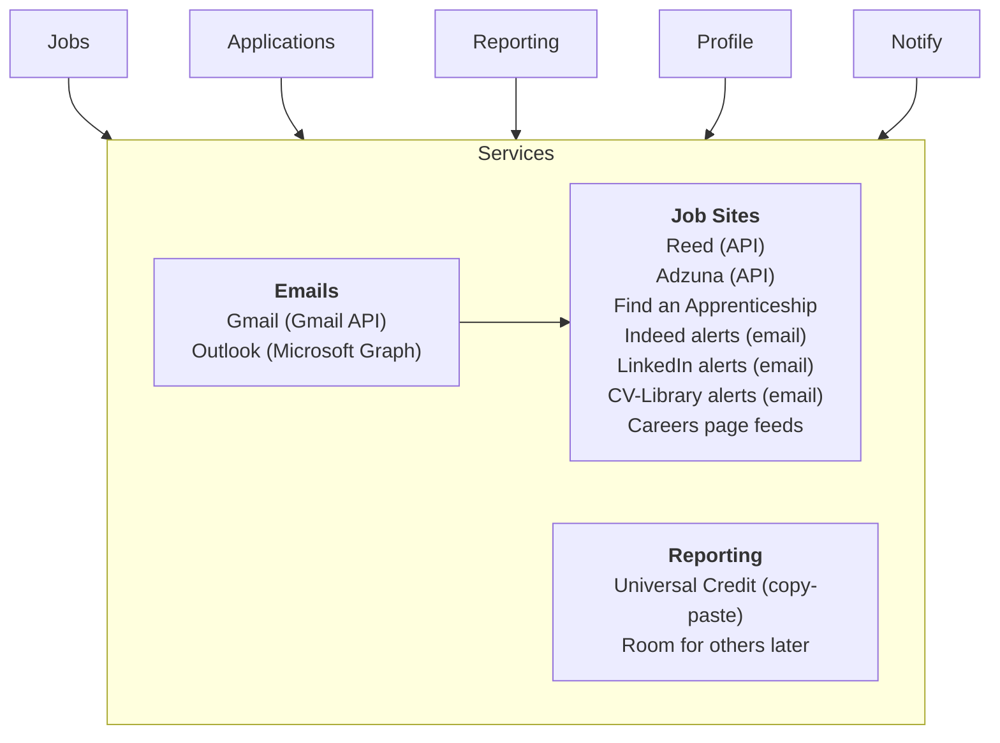

# Job Finder Hub — Product Specification

*Oct 27, 2026 · @Jamie*

## Overview

Job Finder Hub lets one candidate cover the whole job market at once: it finds jobs across many sources, scores them against the candidate's CV and criteria, clusters similar jobs into batches to apply in bulk, and tracks every application's status from email replies.

**Problem:** job hunting means checking several boards, re-typing the same details, losing track of replies, and logging work search for Universal Credit by hand. Applying in bulk this way feels passive and draining.

**Approach:** the hub does the repetitive work (finding, de-duplicating, tracking, formatting reports) so the candidate's energy goes into choosing, tailoring and talking to people.

**User:** a single UK job seeker, mostly on an Android phone, claiming Universal Credit, targeting software, electronics and apprenticeship roles.

## Principles

1. **Nothing leaves without a tap.** Applications, emails and reports stop at draft; the candidate approves each batch and submits.
2. **Read and Writing.** The hub uses official APIs, alert emails and public feeds. Only scrapes or auto-applies on sites when required.
3. **Reporting is a choice.** No action is reported to any service unless the candidate picks it from the Report dropdown.
4. **No activity tracking.** The hub does not time sessions or monitor the candidate. It records actions taken, not time spent.
5. **Private by default.** Data and credentials stay on the candidate's own device or homelab, encrypted at rest.

## Architecture

Five areas sit on one Services layer of plug-ins.

*Architecture · 5 areas over 3 service groups*

| Service group | Members |
|---|---|
| **Emails** | Gmail (Gmail API), Outlook (Microsoft Graph) |
| **Job Sites** | Reed (API), Adzuna (API), Find an Apprenticeship, Indeed alerts (email), LinkedIn alerts (email), CV-Library alerts (email), Careers page feeds |
| **Reporting** | Universal Credit (copy-paste); room for others later |

The areas never talk to sites directly; they ask Services. Alert emails from Indeed, LinkedIn and CV-Library arrive through Emails and are parsed into Job Sites.

## Service operations

Every service is a plug-in with the same base contract, so adding a new board or reporting target means writing one plug-in.

| Group | Operation | What it does |
|---|---|---|
| All services | connect / disconnect | Sign in via OAuth or API key |
| All services | health | Working, broken or needs re-login, plus last checked |
| All services | fetch | Pull anything new since the last check |
| All services | rate limit | Back off politely to avoid being blocked |
| Emails | list new messages | Messages from job-related senders |
| Emails | classify | Job alert, rejection, interview invite, assessment, recruiter outreach, other |
| Emails | link to application | Match a reply to the job it's about |
| Emails | draft reply | Saved as a draft, never auto-sent |
| Job Sites | search | Query with the candidate's criteria (API sources) |
| Job Sites | parse alert | Turn an alert email into job listings |
| Job Sites | get job details | Description, salary, location, closing date |
| Job Sites | open apply page | Hand the candidate the real application form |
| Reporting | format entry | Turn an action into that service's style of text |
| Reporting | queue | Hold entries the candidate chose to report |
| Reporting | copy / copy all | Copy one entry or the batch for pasting |
| Reporting | mark reported | Candidate confirms it was pasted |
| Reporting | undo | Un-report something chosen by mistake |

## App features

Five top-level areas sit on top of Services.

### Jobs

- Ingest from all Job Sites and de-duplicate the same job posted on several boards
- Score each job against the CV and criteria, with one plain sentence on why it might interest the candidate
- Save, dismiss, mark closed

### Applications

- Create from a job; draft a tailored cover note and suggest which CV points to emphasise
- Mark applied; update status manually or from classified emails
- Status board: Found, Applied, Replied, Interview, Offer, Closed
- Follow-up dates, notes and contacts per application

### Reporting

- After any action, a Report dropdown lists the reporting services (Universal Credit first)
- Entry states: Not reported, Ready to paste, Reported
- Per-entry copy, copy all, and a weekly summary
- Logs non-application work search too: CV updates, courses, employer research, interview prep
- Confirmation emails attach to the matching entry as evidence

### Profile

- CV versions
- Criteria file: roles, location, salary floor, must-haves, dealbreakers

### Notify

- New strong matches, replies needing action, follow-ups due, closing dates soon

## Bulk applying (clusters)

- Group matched jobs into clusters of similar roles, e.g. junior Python developer, electronics technician, software apprenticeship
- Each cluster shares one tailored cover note template and one CV version; per-job details (company, role title) fill in automatically
- Candidate reviews the cluster once, can remove jobs or tweak the note, then approves it
- Approved cluster becomes a submit queue: for API-capable sources the hub submits; for all others it opens each pre-filled form in turn for one tap
- Every job in the cluster becomes an Application with status Applied once submitted, and offers the Report dropdown

## Additional features

First after the core: the already-applied guard, CV version tracking and calm mode.

| Feature | What it does | Priority |
|---|---|---|
| Already-applied guard | Warns on a repeat company or role, including agency reposts | First |
| CV version tracking | Records which CV and cover note went to each job | First |
| Calm mode | Daily cap, e.g. the 3 best matches today | First |
| Secure storage and backup | Encrypted tokens and keys; backup of application history | Core |
| Service health alerts | Clear warning when a service breaks or needs relogin | Core |
| Closing dates | Sort by deadline; warn when one is close | Next |
| Interviews | Time, place or link, who, prep notes, calendar event, report option | Next |
| Contacts | Recruiters and people spoken to, linked to applications | Next |
| Scam filter | Flags upfront fees, paid training, vague high-pay, chat-app-only contact | Next |
| Skill gap spotter | Shows skills top matches keep asking for | Next |
| Learns from you | Saves and dismissals adjust future scores | Next |
| Commute check | Public transport time from home | Next |
| Import history | Bring in past applications from a spreadsheet or emails | Later |
| Response stats | Reply rates by source and role type | Later |

## Constraints and out of scope

- **LinkedIn and Indeed:** their terms forbid scraping and automated applying, and LinkedIn bans accounts that do it. The hub reads their alert emails and opens their apply pages only.
- **Universal Credit:** no known public API, and scripting a login to a government account is fragile and risky. The hub formats entries for copy-paste; the candidate pastes them in.
- **Out of scope:** auto-submitting applications, auto-sending emails, session or hours tracking, logging into any account on the candidate's behalf through a bot.

## Tech stack

One Python container and one SQLite file, running under Docker on a Raspberry Pi (arm64, 64-bit OS).

| Layer | Choice | Notes |
|---|---|---|
| Language | Python 3.12 | Type hints throughout |
| Web framework | FastAPI | Serves pages and a small JSON API |
| Templates | Jinja2 + HTMX | Server-rendered; no JS build step |
| Styling | Pico CSS | Light and dark themes built in |
| Database | SQLite via SQLModel | One file on a Docker volume; Alembic migrations |
| Scheduler | APScheduler (in-process) | Fetch jobs and inbox every 60 min (configurable) |
| HTTP client | httpx | Reed and Adzuna APIs, careers page feeds |
| Feeds | feedparser | RSS sources |
| Gmail | google-api-python-client | OAuth 2.0, read and draft scopes only |
| Outlook | msal + Microsoft Graph | Mail.Read and Mail.ReadWrite (drafts) only |
| Matching v1 | rapidfuzz keyword scoring | Against the criteria file |
| Matching v2 | Claude API (optional) | Match reasons, clustering, cover note drafts |
| Notifications | Telegram bot | Posts to a dedicated channel; ntfy as an alternative |
| Remote access | Tailscale + `tailscale serve` | HTTPS certificate; never exposed to the public internet |
| Packaging | Docker Compose | One hub service, `./data` volume, `.env` for secrets |

Criteria and settings live in a YAML file under `./data`, editable in the app's Profile area.

## Security and login

Single user, two layers: Tailscale keeps the hub off the internet, and an app login protects it on the tailnet.

- **Passkey first:** WebAuthn login (`webauthn` library) using the phone's fingerprint or screen lock.
- **Password fallback:** Argon2-hashed (`argon2-cffi`) with optional TOTP (`pyotp`).
- **First run:** no default account. The app prints a one-time setup code to the container logs; it is needed to create the login and expires once used.
- **Sessions:** HttpOnly, Secure, SameSite=Strict cookie; 7-day expiry; log out everywhere option.
- **CSRF:** token on every state-changing request, sent by HTMX as a header.
- **Rate limiting:** login slows after 5 failures and locks for 15 minutes after 10.
- **Secrets at rest:** OAuth tokens and API keys encrypted with Fernet (`cryptography`); the key lives in `.env`, separate from the login and the database.
- **Scopes:** request the narrowest email scopes; never request send permission.
- **Backups:** nightly copy of the SQLite file to `./data/backups`, keeping the last 14.

## Interface and dark mode

Mobile-first, installable PWA for Android; desktop is a wider layout of the same pages.

- **Navigation:** bottom tab bar with Jobs, Applications, Reporting, Profile; Services and Notify settings live under Profile.
- **Theme:** follows the system by default; manual toggle (System, Light, Dark) saved in a cookie and applied server-side so there is no white flash.
- **Dark palette:** soft dark greys, not pure black; theme-color meta tag set per theme so the Android status bar matches.
- **Status badges:** Found, Applied, Replied, Interview, Offer, Closed, each meeting WCAG AA contrast in both themes.
- **Touch:** tap targets at least 44 px; key actions (approve cluster, copy entry, report) reachable with one thumb.
- **Copy buttons:** one tap copies a Reporting entry, with a brief confirmation toast.

## Data model

| Table | Key fields |
|---|---|
| `user` | id, passkey credentials, password_hash, totp_secret (encrypted), created_at |
| `service` | id, kind (email, job_site, reporting), name, config, credentials (encrypted), health, last_checked |
| `job` | id, source_service_id, external_id, title, company, location, salary_min, salary_max, url, description, closing_date, fingerprint (for de-duplication), score, match_reason, state (new, saved, dismissed, closed) |
| `cluster` | id, name, cover_note_template, cv_version_id, state (draft, approved, done) |
| `cluster_job` | cluster_id, job_id |
| `application` | id, job_id, cluster_id, cv_version_id, cover_note, status (found, applied, replied, interview, offer, closed), applied_at, follow_up_on, notes |
| `email_message` | id, service_id, external_id, from, subject, received_at, category, application_id |
| `cv_version` | id, label, file_path, created_at |
| `contact` | id, name, company, email, phone, notes |
| `interview` | id, application_id, starts_at, location_or_link, people, prep_notes |
| `report_entry` | id, reporting_service_id, application_id (nullable), activity_type, text, state (ready, reported), created_at, reported_at, evidence_email_id |

The already-applied guard compares a new job's company and normalised title with existing applications from the last 6 months.

## Build phases

Build in this order; each phase ends with its acceptance checks passing.

1. **Skeleton and login**
   - Docker Compose runs on arm64; app reachable over `tailscale serve` with HTTPS
   - First-run setup code creates the account; passkey and password login work; rate limiting and CSRF in place
   - Theme toggle works with no flash; layout usable at 360 px wide
2. **Jobs**
   - Reed and Adzuna plug-ins fetch on schedule; service health shows on Profile
   - Duplicate listings collapse into one job; keyword score and match reason shown
   - Save, dismiss, closing-date sort; calm mode cap on the daily list
3. **Applications and clusters**
   - Create clusters from saved jobs; shared cover note and CV version; approve to make a submit queue
   - Already-applied guard warns before a duplicate is added
   - Status board with manual updates and follow-up dates
4. **Emails**
   - Gmail and Outlook connect via OAuth with read and draft scopes only
   - Alert emails from Indeed, LinkedIn and CV-Library parse into jobs
   - Replies are classified and update the linked application's status
5. **Reporting**
   - Report dropdown on every action; Universal Credit entries formatted for pasting
   - Copy, copy all, weekly summary, mark reported, undo; evidence emails attached
6. **Notify and extras**
   - Telegram notifications for strong matches, replies needing action, follow-ups and closing dates
   - Optional Claude API matching and drafting behind a setting
   - Interviews, contacts, scam filter, then the rest of Additional features by priority

**Tests:** pytest for each plug-in using recorded sample responses, and for scoring, de-duplication, the already-applied guard and report formatting.

## Open questions

Each has a default so building can start now.

- [x] ~~Platform: web app on the Raspberry Pi, opened from the phone as a PWA~~
- [x] ~~Login: passkey first, password plus optional TOTP as fallback~~
- [ ] Pi model and RAM (default: assume a Pi 4 with 4 GB; no local language models)
- [ ] First criteria file (default: three clusters scored separately: software apprenticeships, junior developer, electronics or repair technician)
- [ ] Reporting cadence with the work coach (default: per-entry copy plus weekly summary)
- [ ] Deliver notifications through the ADHD secretary's check-ins (default: Telegram channel)
